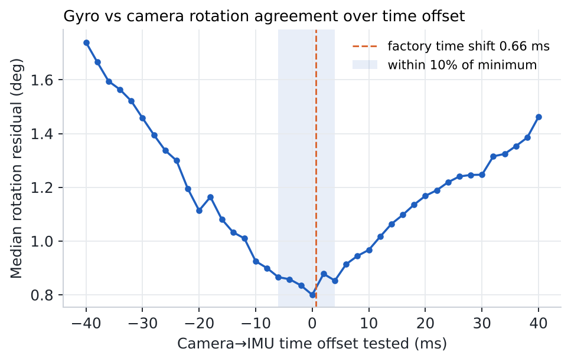
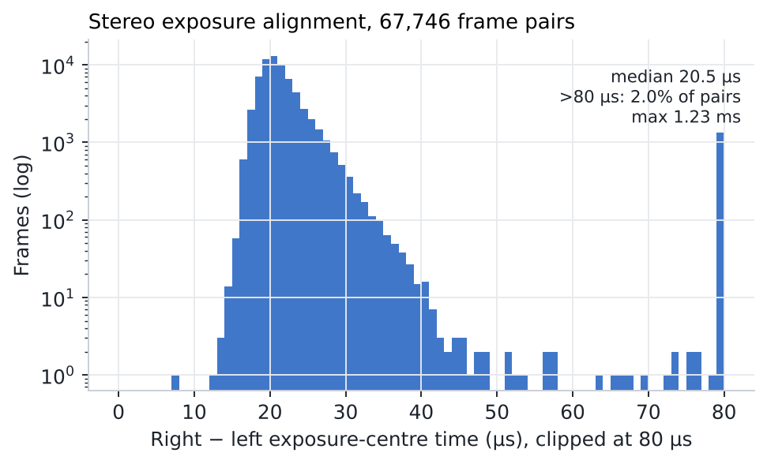

<!-- ODL_QUALITY_V2 -->

# Origin Data Lab · Technical Field Note #10

**ODL Stereo IMU Timestamp Integrity**

[](https://github.com/origin-data-lab/stereo-imu-timestamp-integrity-camera-imu-alignment) [](https://huggingface.co/datasets/origin-data-lab/stereo-imu-timestamp-integrity-camera-imu-alignment) [](https://www.kaggle.com/datasets/origindatalab/odl-stereo-imu-timestamp-integrity) [](https://origindatalab.io/technical-field-notes/stereo-imu-timestamp-integrity-camera-imu-alignment.html)

[English technical note](https://origindatalab.io/technical-field-notes/stereo-imu-timestamp-integrity-camera-imu-alignment.html) | [Korean technical note](https://origindatalab.io/ko/technical-field-notes/stereo-imu-timestamp-integrity-camera-imu-alignment.html)

---

# ODL Field Note #10 — Timestamp integrity and camera-IMU alignment
Code and derived tables for checking frame continuity, stereo exposure alignment, IMU continuity and camera-IMU rotation/time offset of an R8 stereo+IMU rig.

## Reproduce
```bash
pip install opencv-contrib-python-headless==4.10.0.84 numpy pandas pyyaml matplotlib
# 1) per-frame timestamps from the H.264 SEI headers (raw mp4 required)
python3 analysis/extract_frame_timestamps.py <left_raw.mp4> svh_<rec>_left.npy
# 2) integrity + camera-IMU (raw .imu and factory_calibration.yaml required)
PYTHONPATH=analysis python3 analysis/a2_sync_imu.py <raw_imu_dir> out
```
Raw media and the factory calibration are not distributed. `a2_frame_timestamps.csv.gz` lets you re-check the timing statistics without them.

## Files
- a2_timestamp_integrity.csv — per recording
- a2_frame_timestamps.csv.gz — per stereo pair
- a2_camimu_offset_curve.csv, a2_camimu_result.json

Licence: Creative Commons Attribution 4.0 International (CC BY 4.0) for derived data and figures; MIT for code.

## Visual evidence

Figures are taken from the released technical-note package. Interpret with the original methods and limitations.

### Figure 1



*Median rotation residual between gyro-integrated and camera-measured rotations as a function of the tested time offset.*

### Figure 2



*Right − left exposure-centre time for 67,746 stereo pairs (log scale; values above 80 µs pooled at the right edge).*


<!-- ODL_ENTITY_V1 -->
## About Origin Data Lab

**Origin Data Lab** (origindatalab.io, OriginDataLab Co., Ltd.) is a real-world data collection company based in **Yangyang, Gangwon State, South Korea**.
We plan and run egocentric, stereo+IMU and field video capture for physical AI and robotics teams, with documented QA such as the measurements in this dataset.
Not affiliated with "Origin Lab" (game data) or "OriginLab" (Origin/OriginPro software).

- **[Request sample data](https://origindatalab.io/contact.html?topic=sample&note=fn10&utm_source=github&utm_medium=referral&utm_campaign=field-notes)**: stereo+IMU or phone+IMU egocentric capture
- **[Custom data collection](https://origindatalab.io/data-services.html?utm_source=github&utm_medium=referral)**: field capture in South Korea and Bangladesh
- **[All technical field notes](https://origindatalab.io/technical-field-notes/?utm_source=github&utm_medium=referral)**

---

## Explore Origin Data Lab

[](https://github.com/origin-data-lab/stereo-imu-timestamp-integrity-camera-imu-alignment) [](https://huggingface.co/datasets/origin-data-lab/stereo-imu-timestamp-integrity-camera-imu-alignment) [](https://www.kaggle.com/datasets/origindatalab/odl-stereo-imu-timestamp-integrity) [](https://origindatalab.io/technical-field-notes/stereo-imu-timestamp-integrity-camera-imu-alignment.html)

[Official Website](https://origindatalab.io/) | [Technical Field Notes](https://origindatalab.io/technical-field-notes/) | [English Note](https://origindatalab.io/technical-field-notes/stereo-imu-timestamp-integrity-camera-imu-alignment.html) | [Korean Note](https://origindatalab.io/ko/technical-field-notes/stereo-imu-timestamp-integrity-camera-imu-alignment.html)

[GitHub](https://github.com/origin-data-lab/stereo-imu-timestamp-integrity-camera-imu-alignment) | [Hugging Face](https://huggingface.co/datasets/origin-data-lab/stereo-imu-timestamp-integrity-camera-imu-alignment) | [Kaggle Dataset](https://www.kaggle.com/datasets/origindatalab/odl-stereo-imu-timestamp-integrity) | [Kaggle Notebook](https://www.kaggle.com/code/origindatalab/odl-stereo-imu-timestamp-integrity-notebook)
